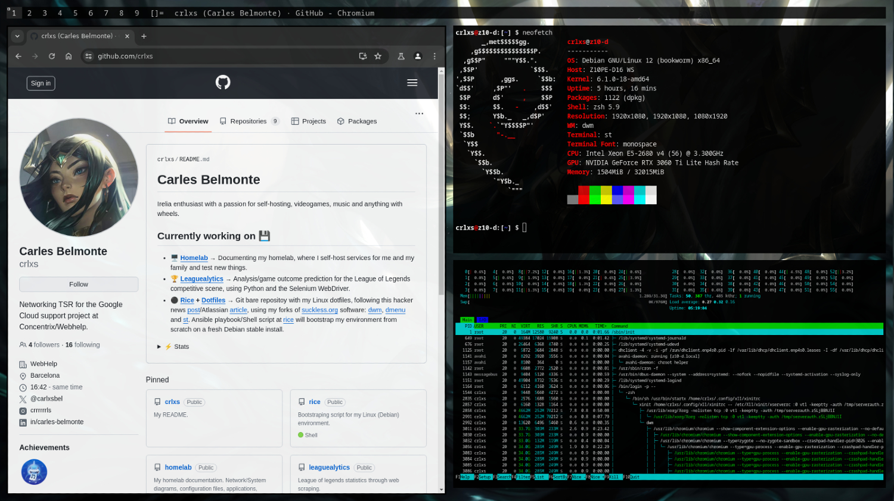

# Rice

Ansible setup for a Debian 12+ desktop with dwm, dmenu, st, Zsh, Neovim, fonts, and dotfiles. Requires x86_64 or ARM64, internet, and sudo access. Run as your desktop user, without `sudo`.

## Install

```sh
sudo apt update
sudo apt install -y ansible-core git ca-certificates
mkdir -p ~/.local/src ~/.local/share
git clone https://github.com/crlxs/rice.git ~/.local/src/rice
cd ~/.local/src/rice
ansible-playbook -i localhost, setup.yaml --ask-become-pass
```

Skip the clone if the checkout already exists. The first clone uses HTTPS because the SSH key is not set up yet. The default run does **not** restore that key. To restore the existing vaulted key on the first run, use this playbook command instead:

```sh
ansible-playbook -i localhost, setup.yaml --tags common,suckless,gitssh --ask-become-pass --ask-vault-pass
```

The key must already be authorized on GitHub. The playbook keeps HTTPS for fetching and uses SSH for pushing.

## Start

Log out and back in, then run `startx` from a local text console. Existing clones are not updated automatically.

[Detailed guide](docs/guide.md): task tags, SSH setup, reruns, migration, appearance, validation, publishing, and shortcuts.


